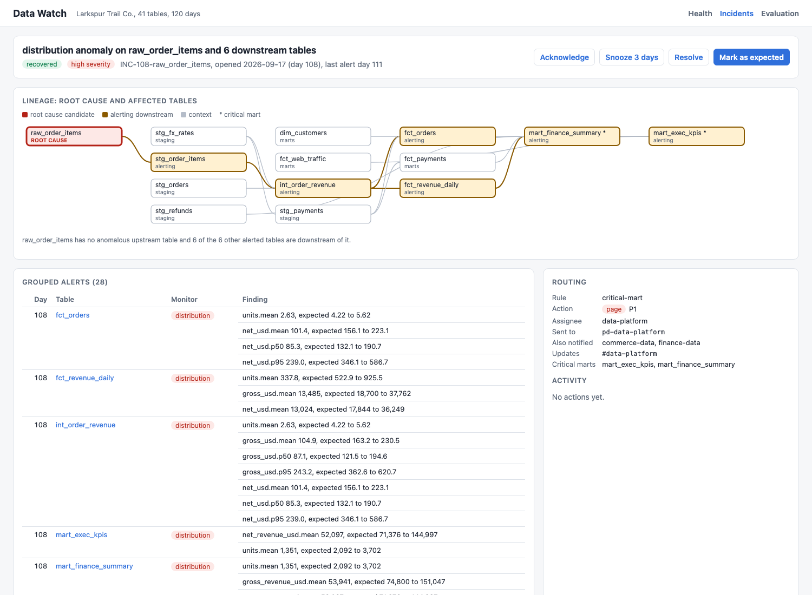
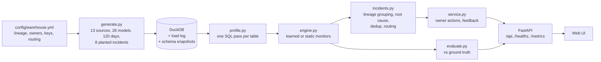
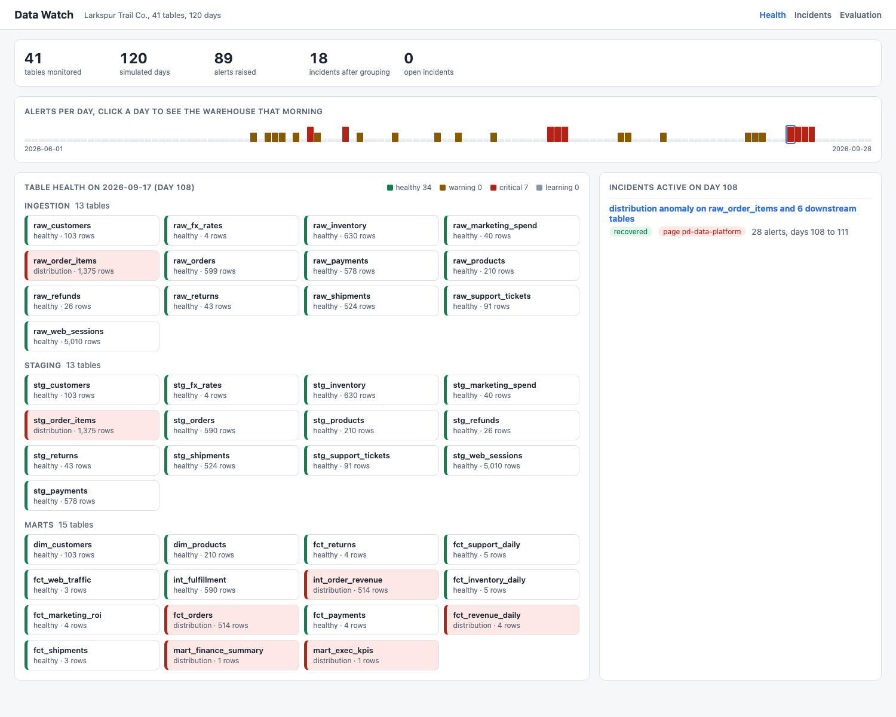
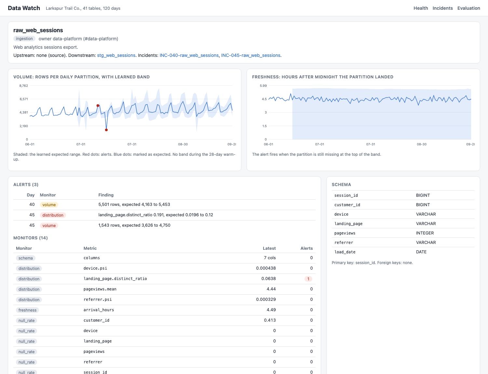

# Data Watch

Data observability for the warehouse of Larkspur Trail Co., a made-up online outdoor gear retailer. The warehouse is 41 DuckDB tables across ingestion, staging, and marts, loaded daily for 120 simulated days with weekday and weekend patterns, month-end sales, and two holidays. Data Watch profiles every daily partition, learns what normal looks like for each table and column, raises alerts when a load is late, short, duplicated, reshaped, or wrong, groups related alerts into one incident by following lineage, names the most upstream table as the root cause, and routes the incident to its owner. Eight incidents are planted with ground truth, and the evaluation scores learned baselines against the static thresholds most teams start with.



## Results

120 days, 41 tables, 519 monitored metrics, scored after a 28-day warm-up (13 weeks). From `make eval`, also in [docs/evaluation.md](docs/evaluation.md) and [docs/evaluation.json](docs/evaluation.json).

| Incident type | Source table | Learned: detected | Learned: time to detect | Static: detected | Static: time to detect | Root cause correct | Tables flagged / downstream reach |
|---|---|---|---|---|---|---|---|
| volume drop (partial load) | `raw_web_sessions` | yes | 0.0 h | yes | 0.0 h | yes | 5 / 5 |
| freshness (late load) | `raw_inventory` | yes | 1.1 h | yes | 5.0 h | yes | 3 / 3 |
| schema (INTEGER to VARCHAR) | `raw_customers` | yes | 0.0 h | yes | 0.0 h | yes | 1 / 4 |
| volume spike (duplicate load) | `raw_shipments` | yes | 0.0 h | yes | 0.0 h | yes | 1 / 4 |
| distribution shift (amounts in cents) | `raw_payments` | yes | 0.0 h | yes | 0.0 h | yes | 5 / 6 |
| null rate (email) | `raw_customers` | yes | 0.0 h | yes | 0.0 h | yes | 3 / 4 |
| referential (orphaned order ids) | `raw_returns` | yes | 0.0 h | yes | 0.0 h | yes | 2 / 5 |
| silent upstream bug (6 downstream tables) | `raw_order_items` | yes | 0.0 h | yes | 0.0 h | yes | 7 / 7 |

| Metric | Learned baselines | Static thresholds |
|---|---:|---:|
| Detection rate | 100% | 100% |
| Alerts (one per table, monitor, and day) | 89 | 1,150 |
| False alerts | 23 | 1,025 |
| False alerts per table per week | 0.043 | 1.902 |
| Incidents after lineage grouping | 18 | 7 |
| Incidents with no planted cause | 10 | 5 |
| Root cause correct | 100% | 12% |
| Pages, tickets, and updates sent | 26 | 222 |

What the numbers say:
- Both approaches catch all eight planted incidents. The difference is noise: static rules raise about 45 times as many false alerts, mostly every weekend and month-end, because they compare to a flat trailing 7-day mean. Learned baselines pick a weekday model per metric and learn the month-end effect from earlier month-ends.
- Grouping turns 89 alerts into 18 incidents. The silent bug alone fires 28 alerts on 7 tables over 4 days and becomes one page. On static alerts, grouping backfires: daily noise chains unrelated alerts into 7 giant incidents, so only 1 of 8 gets the right root cause.
- Time to detection is 0 h for everything except freshness because monitors run when a partition lands. For the 10 hour late inventory load, the learned deadline (median arrival plus a MAD-based margin) fires 1.1 h after the usual arrival; a fixed 8 h rule waits 5 h.
- 10 of the 18 learned incidents are false (noise at roughly 4 sigma on small tables and quantiles). That is 0.043 false alerts per table per week; CI fails above 0.1.
- The planted incidents and the detector were written by the same person, so 100% is a regression baseline, not a claim about arbitrary data.

## Why

Pipelines rarely fail loudly. A partner export times out and loads a third of the rows, a processor starts sending cents, a release writes quantity 1 on every order line. Every job succeeds, and the finance mart is wrong by Monday. Fixed thresholds either miss these or fire every Saturday until people mute them. A useful monitor has to learn each table's own rhythm, stay quiet through weekends and month-end, and when something breaks upstream, send one page to the team that owns the source instead of twelve pages to everyone downstream.

## What it does

| Area | How |
|---|---|
| Freshness | Arrival time of each partition versus the median of its history plus a margin (k times the MAD, at least 1 h). Fires at the deadline, not when the late data finally lands. |
| Volume | Rows per partition versus a seasonal baseline: flat or day-of-week, chosen per metric by which leaves smaller residuals; drift from week-over-week change; month-end uplift learned from earlier month-ends; wide lower bound on declared holidays. Bands are in log space so they are relative. |
| Schema | Diff of each daily snapshot against the previous one: removed, added, and retyped columns. |
| Distribution | Mean, median, and p95 of numeric columns (quantiles only where a partition has 50+ rows and the column is not a handful of discrete values), distinct ratio of high-cardinality text, and PSI for categoricals with a threshold that accounts for sampling noise at that day's row count. |
| Null rate, uniqueness, referential integrity | Rates with a band that is the larger of the history's MAD and the binomial noise at today's sample size, so a 60 row table gets a wider band than a 6,000 row one. Foreign keys are declared in the YAML. |
| Baselines | Medians and MADs only, so one bad day does not widen the band. 28-day warm-up per metric. Alerted days are kept out of the history so a multi-day incident keeps alerting. Refit weekly, scored daily. Sensitivity low, medium, or high (6, 4.5, or 3.5 MAD units), per table if needed. |
| Grouping and root cause | Alerted tables on the same day are linked when one is upstream of the other. A group joins an open incident from the last 2 days when they share a table or sit on the same lineage path. The root cause candidate is the alerted table with no alerted ancestor, preferring the one that explains the most alerted descendants. |
| Routing | First matching rule from the YAML: any critical mart affected pages the root owner's pager; a high-severity source issue opens a P2 ticket; everything else a P3 ticket. Owners of affected tables are notified. Later alerts post updates instead of new pages. |
| Owner actions | Acknowledge, snooze, resolve, reopen, and mark as expected. Mark as expected puts those points back into the baselines and refits the affected metrics; when two or more days are accepted, older history is shifted to the new level. Actions persist in `data/state.json`. |

## Architecture



The warehouse is real SQL: source tables are generated with seeded hashes in DuckDB, incidents are applied to source partitions, and the 28 staging and mart models are built from those sources, so a bad source propagates to exactly the tables that read it. The loader records arrival times and an `information_schema` snapshot per day, which is what freshness and schema monitors read.

## Run it

```bash
cd data-watch
uv sync --python 3.12
uv run datawatch eval --gate      # builds data/warehouse.duckdb (2.2M rows, about 3 s), prints the tables above
uv run datawatch serve --port 8855
# open http://127.0.0.1:8855
```

`make test`, `make lint`, `make eval`, `make gate`, `make run`, `make screenshot` (headless Chrome, server running). `DATAWATCH_SCALE=0.3` makes a smaller warehouse; it still passes the gate.

API: `GET /api/tables?day=N`, `GET /api/tables/{name}`, `GET /api/incidents`, `GET /api/incidents/{id}`, `POST /api/incidents/{id}/actions` with `{"action": "acknowledge" | "snooze" | "resolve" | "reopen" | "expected", "days": 3, "note": "..."}`, `GET /api/evaluation`, `GET /api/lineage`, `GET /healthz`, `GET /metrics`. Logs are one JSON object per line.

Docker is not installed on the development machine; the image is built and smoke tested in CI (`docker build -t data-watch . && docker run -p 8855:8855 data-watch`). The container generates the warehouse into `/app/data` on first start.

## UI

| Health overview | Table detail |
|---|---|
|  |  |

The overview has an alerts-per-day timeline; click a day to see the warehouse that morning. Table pages chart volume and freshness with the learned band (one y-axis each). The evaluation page shows the tables above. Light and dark mode follow the system setting ([dark incident page](docs/incident-dark.png)).

## How this maps to commercial data observability tools

| Concept here | Category in commercial tools |
|---|---|
| Freshness, volume, schema monitors on every table with no setup | Automatic table-level monitors ("pipeline health") |
| Distribution, null rate, uniqueness, PSI per column | Field-level health or data quality monitors |
| Learned bands with warm-up, weekday model, month-end, holidays | ML-based anomaly detection with seasonality |
| Referential checks on declared keys | Data contracts and validation rules |
| Lineage from YAML, grouping by lineage, root cause candidate | Lineage-aware incident correlation and root cause analysis |
| Owners, critical marts, page versus ticket rules | Domain ownership and alert routing to on-call and ticketing |
| Acknowledge, snooze, resolve, mark as expected | Incident triage workflow and anomaly feedback |
| Static versus learned evaluation | Threshold rules in data testing frameworks versus learned monitors |

## Tests

93 tests, about 25 seconds (`uv run pytest -q`):
- baselines (23): median and MAD, warm-up, weekday versus flat model choice, a seasonal series with no false alerts while a flat rule fires on weekends, drops and spikes on weekdays and weekends, adaptive bands for noisy tables, sensitivity, month-end band before and after one is seen, holidays, drift, binomial rate bands, PSI with new categories and its noise threshold, re-leveling
- engine (18): each monitor on hand-built series (volume, freshness and its detection time, null rate, duplicates, orphans, cents shift, PSI, schema diff), warm-up, alerted days kept out of the baseline, static rules on weekends, mark as expected for a level shift and for a one-day spike
- incidents (12): lineage grouping, root cause selection and tie breaks, dedup across days and the gap, root moving upstream, routing rules, statuses, notifications and snooze
- config and warehouse (18): layer counts, every model's SQL reads exactly its declared upstream tables, 6 tables below the silent bug, validation errors, schema matches YAML, 120 partitions everywhere, weekend, month-end, and holiday volume, each incident present in the data, determinism
- evaluation (10) and API end to end (12): all incidents detected with the right root cause, accounting, gate pass and fail, every endpoint, actions and persistence across restart, mark as expected removing alerts, JSON logs

CI runs ruff, the tests, a detection gate (`datawatch eval --gate --max-false-per-table-week 0.1`), and a Docker build with a container smoke test.

## Production notes

- Profiling would run as incremental queries per new partition against the warehouse (or read its metadata tables for row counts and freshness) instead of scanning 120 days at once, with results stored in a metrics table.
- Lineage would come from the transformation tool's manifest or query logs instead of a hand-written YAML; column-level lineage would make grouping sharper.
- Baselines would be refit on a schedule per metric with a holiday calendar per region, and stored with their version so an alert can be explained later.
- Routing would call the paging and ticketing APIs with idempotency keys per incident, and state would live in Postgres instead of a JSON file.
- Thresholds would be tuned per domain from feedback: how often owners mark incidents as expected is the false positive rate that matters.

## License

MIT. See [LICENSE](LICENSE).
